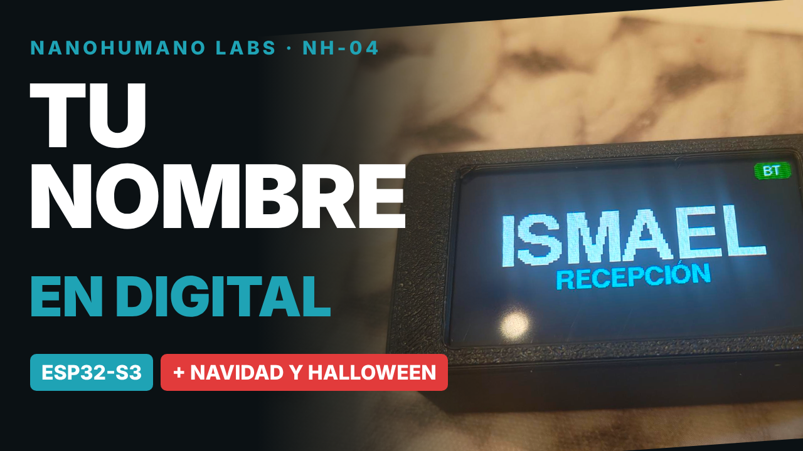
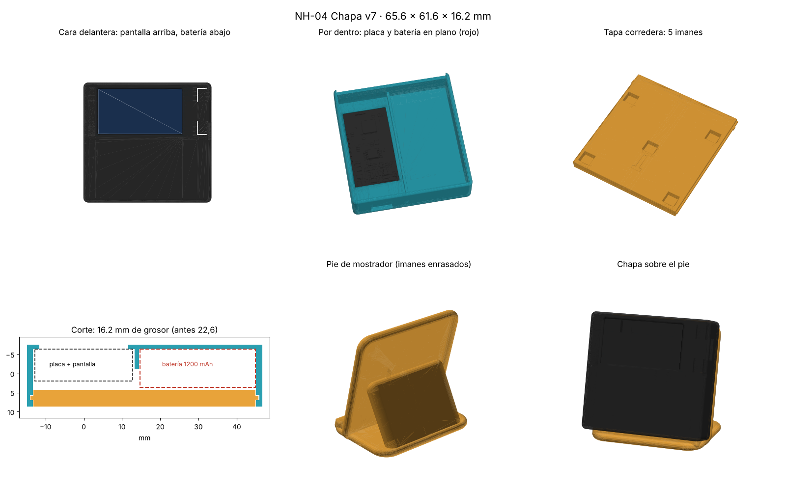

# NH-04 Chapa · NANOHUMANO LABS

Chapa de nombre digital con una **LILYGO T-Display S3**: se cambia desde el móvil por Bluetooth, la pueden compartir varias personas y tiene temas animados de Navidad, Halloween y un calendario de Adviento hasta Reyes. La caja se imprime en 3D y se sujeta a la ropa con imanes.

- 🎬 **Vídeo:** https://youtu.be/ANPzw-ODm4M
- 🖨️ **STL (Printables):** https://www.printables.com/model/1909584
- 📱 **App de control:** https://nanohumano.github.io/chapa-nh/ (Chrome o Edge, en Android o PC con Bluetooth)

## Hardware

| Componente | Detalle |
|---|---|
| Placa | LILYGO T-Display S3 (ESP32-S3R8, LCD 1,9" 170×320, 16 MB flash, 8 MB PSRAM) |
| Batería | LiPo 103040 de 1200 mAh (caja plana) o 802540 de 800 mAh (caja gruesa), conector JST 1,25 mm |
| Imanes | Discos de neodimio de 6 × 3 mm: 5 en la tapa, 5 en la contraplaca (y 5 en el pie, si lo haces) |
| Caja | Dos versiones a elegir, en PLA y sin soportes (ver [Caja](#caja)) |

> Hay una versión AMOLED y otra táctil de la T-Display S3: este firmware y esta caja son para la **versión LCD normal**.
> Antes de conectar la batería, comprueba que el cable rojo va al **+** de la placa.

## Software

- Arduino IDE 2 con el core **esp32 de Espressif 2.0.14** (versiones posteriores no funcionan bien con TFT_eSPI en esta placa)
- Librería **TFT_eSPI**: en `User_Setup_Select.h` comenta `#include <User_Setup.h>` y activa `#include <User_Setups/Setup206_LilyGo_T_Display_S3.h>`
- Librerías del core: BLE, Preferences

### Configuración de la placa

| Opción | Valor |
|---|---|
| Placa | ESP32S3 Dev Module |
| USB CDC On Boot | Enabled |
| Flash Size | 16MB (128Mb) |
| PSRAM | OPI PSRAM (necesaria para las animaciones) |
| Partition Scheme | 16M Flash (3MB APP/9.9MB FATFS) |

No hay WiFi ni contraseñas: todo se configura desde la app por Bluetooth.

## Uso

| Botón | Acción |
|---|---|
| BOOT corto | Cambia de pantalla: nombre, reloj, mensaje, info |
| BOOT 2 s | Cambia de persona (hasta 4 perfiles) |
| KEY corto | Brillo |
| KEY 2 s | Activa el Bluetooth 3 minutos para la app |

En la app: **Conectar** → **NH-Chapa**. Desde ahí se cambian nombre, empresa o puesto, tipo de letra, tamaño, tema, brillo y mensaje. Al conectar se sincroniza la hora.

**Temas:** Normal, Navidad, Halloween, Calendario de Adviento (1 de diciembre a 6 de enero) y Automático según la fecha.

**Batería:** icono al 20 %, aviso en pantalla al 10 %, modo ahorro al 5 % y apagado seguro a 3,3 V (se enciende con KEY o RST). Los perfiles se guardan en la placa; la hora se vuelve a sincronizar al conectar la app si la batería se agota del todo.

## Caja

Hay **dos versiones** para elegir; las dos funcionan con el mismo firmware y la misma app. Comparativa completa en [`caja/LEEME.md`](caja/LEEME.md).

| Versión | Batería | Medidas | Piezas |
|---|---|---|---|
| [**Plana** (nueva)](caja/plana_1200mAh/) | 103040 · 1200 mAh, en plano bajo la pantalla | 65,6 × 61,6 × 16,2 mm | Cuerpo, tapa, contraplaca y pie de mostrador |
| [**Gruesa** (original)](caja/gruesa_800mAh/) | 802540 · 800 mAh, detrás de la placa | 29,8 × 65,6 × 22,6 mm | Cuerpo, tapa y contraplaca |

PLA, capa 0,2 mm, 3 perímetros, relleno 20 %, sin soportes. Los STL se generan con Python (carpeta `caja/`) a partir de las medidas del modelo 3D oficial de LILYGO.

## Archivos

| Ruta | Contenido |
|---|---|
| `firmware/chapa_nh/chapa_nh.ino` | Firmware para Arduino IDE |
| `index.html` | App web de control (GitHub Pages) |
| `caja/` | STL, generador de la caja e imágenes |

## Opina, pregunta o propón mejoras

- 💬 **Ideas, dudas y fotos de tu chapa:** pestaña [Discussions](https://github.com/Nanohumano/chapa-nh/discussions)
- 🐞 **Algo no funciona:** abre un [Issue](https://github.com/Nanohumano/chapa-nh/issues) (placa, versión del core y qué ves en pantalla)
- 🛠️ **Quieres cambiar el código:** haz un *fork* y envía un *pull request*. Lo reviso antes de aceptarlo; nadie más puede modificar este repositorio directamente.
- ⭐ Si te gusta, deja una estrella y cuéntalo en los comentarios del [vídeo](https://youtu.be/ANPzw-ODm4M) o de [Printables](https://www.printables.com/model/1909584).

## Licencia

MIT © Nanohumano Labs
