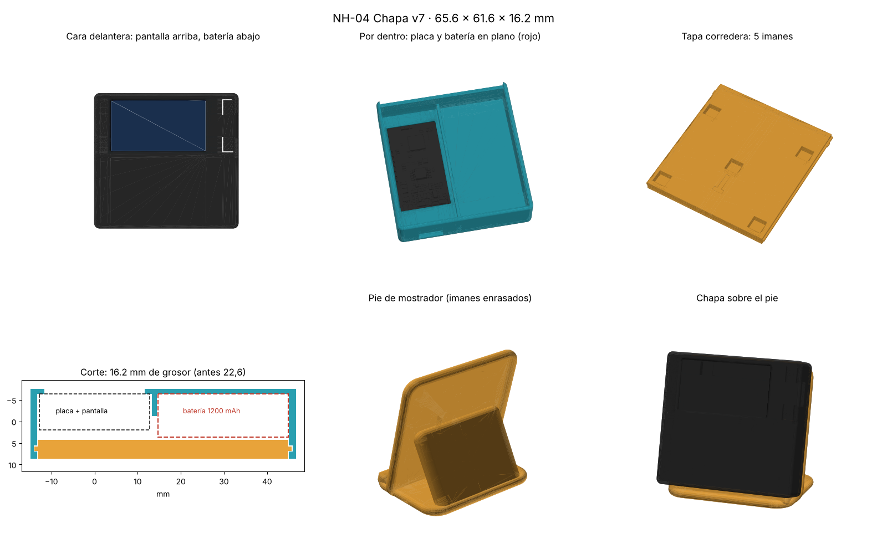
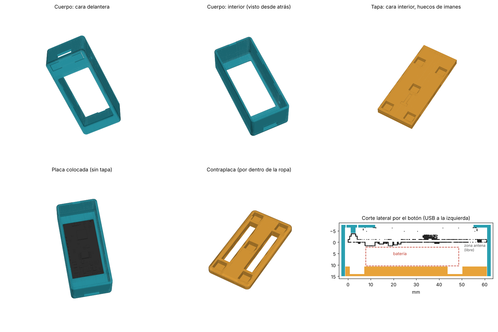
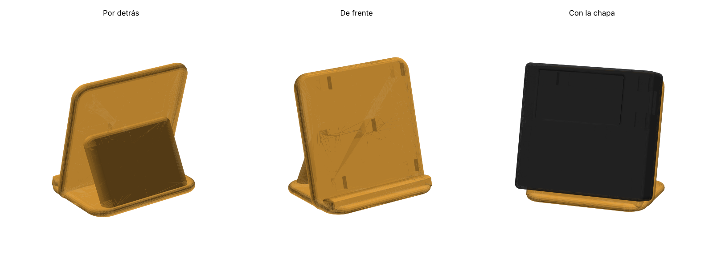

# Caja Chapa NH: elige versión

Hay dos cajas. Las dos usan la misma placa (LILYGO T-Display S3), el mismo firmware y la misma app, y se sujetan con imanes de disco de 6 × 3 mm.

| | [Plana · 1200 mAh](plana_1200mAh/) (nueva) | [Gruesa · 800 mAh](gruesa_800mAh/) (original) |
|---|---|---|
| Vista previa |  |  |
| Batería | LiPo **103040** (10 × 30 × 40 mm), 1200 mAh | LiPo **802540** (8 × 25 × 40 mm), 800 mAh |
| Dónde va la batería | En plano, debajo de la pantalla | Detrás de la placa |
| Medidas | 65,6 × 61,6 × **16,2 mm** | 29,8 × 65,6 × **22,6 mm** |
| Forma | Casi cuadrada, más fina | Alargada, más gruesa |
| Piezas | Cuerpo, tapa, contraplaca y **pie de mostrador** | Cuerpo, tapa y contraplaca |
| Pie |  | — |
| Imanes | 5 tapa + 5 contraplaca + 5 pie | 5 tapa + 5 contraplaca |

## Impresión (las dos)
- PLA o PETG, capa 0,2 mm, 3 perímetros, relleno 20 %, sin soportes.
- Cuerpo con la cara de la pantalla sobre la cama; tapa y contraplaca con la cara lisa sobre la cama; el pie tal cual, sobre su base.
- Antes de pegar los imanes, comprueba que se atraen (tapa con contraplaca, y tapa con pie).
- La tapa entra deslizando desde el extremo de la antena y hace clic al final. Para abrirla, engancha la uña en la ranura.
- **Conector:** la placa usa JST de 1,25 mm. Si tu batería trae otro, cámbialo y comprueba que el cable rojo va al «+».

## Notas de la versión plana
- Mirándola de frente: pantalla arriba, batería abajo y USB a la derecha.
- El hueco de la batería es más largo que la batería: sujétala con cinta de doble cara. El cable pasa por detrás de la placa.
- El botón RST del canto queda hacia la batería: se pulsa con la tapa abierta.
- El pie inclina la chapa 15° y la sujeta con los mismos imanes de la tapa. Es de cantos redondeados y los imanes van **enrasados en la cara delantera** (se pegan desde delante, con la cara buena hacia fuera).
- En `plana_1200mAh/otros_pies/` hay dos pies alternativos: **low poly** (facetado) y **básico** (con nervios; sus imanes se meten por detrás).

## Generar los STL (Python 3 + numpy)
- Plana: `python3 caja_chapa_nh.py <carpeta>` y `python3 caja_chapa_nh.py <carpeta> --pie` (añade `--todos` para los pies alternativos; necesita scipy)
- Gruesa: `cd gruesa_800mAh && python3 caja_chapa_nh_v6.py <carpeta>`
- Otro tamaño de imán: `IMAN_D=8 IMAN_G=2 python3 caja_chapa_nh.py <carpeta>`

Las medidas de la placa salen del modelo 3D oficial de LILYGO.
